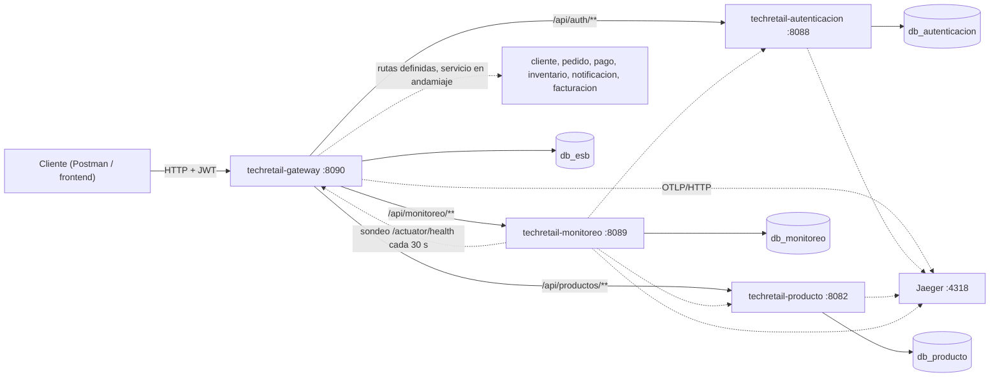

# Documento Técnico — TechRetail SOA

| Campo | Valor |
|---|---|
| Sistema | TechRetail SOA (plataforma de comercio electrónico de TechRetail S.A.) |
| Tipo de documento | Mapa técnico de arquitectura |
| Estado del sistema | Fase P0 completada: 4 servicios funcionales, 6 servicios en andamiaje |
| Pruebas automatizadas | 127 en verde (115 en servicios funcionales + 12 de contexto en andamiajes) |
| Fuente de verdad | `pom.xml` de cada módulo, `application.properties` y `docker-compose.yml` |

> [!NOTE]
> Los documentos de avance (`Avance1`, `Avance2`, `PLAN_PROYECTO_SOA`) describen la intención arquitectónica, pero algunas de sus afirmaciones de stack son antiguas (Spring Boot 3.x, Java 17, 9 servicios). Este documento refleja el código actual.

---

## 1. Visión general

TechRetail SOA es un conjunto de **diez servicios Spring Boot independientes** que se comunican a través de un **BUS de servicios** (`techretail-gateway`), único punto de entrada para los clientes externos.

Principios aplicados:

- **Punto único de entrada:** todo el tráfico externo entra por el gateway (puerto 8090), que enruta, valida el JWT y audita.
- **Base de datos por servicio (*Database per Service*):** cada servicio es dueño exclusivo de su base PostgreSQL. Ningún servicio lee las tablas de otro.
- **Seguridad en profundidad (Zero Trust):** el gateway valida el JWT y, además, cada servicio funcional vuelve a validarlo por sí mismo.
- **Esquema gobernado por migraciones:** Flyway crea y versiona las tablas; Hibernate solo valida (`ddl-auto=validate`).
- **Observabilidad:** trazas distribuidas con OpenTelemetry exportadas a Jaeger, sondas de salud con Actuator, monitoreo activo y auditoría de transacciones.



---

## 2. Inventario de microservicios

| Módulo | Puerto | Base de datos | Estado | Responsabilidad |
|---|---|---|---|---|
| `techretail-gateway` | 8090 | `db_esb` | **Funcional** | BUS/ESB: enrutamiento, validación JWT, política por rol, auditoría asíncrona, consulta de auditoría |
| `techretail-autenticacion` | 8088 | `db_autenticacion` | **Funcional** | Registro de usuarios, login, emisión de JWT, usuarios de demostración |
| `techretail-producto` | 8082 | `db_producto` | **Funcional** | Catálogo de productos y categorías |
| `techretail-monitoreo` | 8089 | `db_monitoreo` | **Funcional** | Sondeo periódico de la salud de los demás servicios e historial |
| `techretail-cliente` | 8081 | `db_cliente` | Andamiaje | Gestión de clientes |
| `techretail-pedido` | 8083 | `db_pedido` | Andamiaje | Orquestación del proceso de compra |
| `techretail-pago` | 8084 | `db_pago` | Andamiaje | Procesamiento de pagos |
| `techretail-inventario` | 8085 | `db_inventario` | Andamiaje | Stock, reservas y alertas |
| `techretail-notificacion` | 8086 | `db_notificacion` | Andamiaje | Envío de notificaciones (consumidor de eventos) |
| `techretail-facturacion-sunat` | 8087 | `db_facturacion` | Andamiaje | Facturación electrónica vía SOAP |

"Andamiaje" significa: una clase `*Application`, una migración Flyway `V1`, y ninguna entidad ni controlador. El servicio arranca y pasa su prueba de contexto, pero no expone lógica de negocio.

---

## 3. Stack tecnológico

| Capa | Tecnología | Versión | Uso |
|---|---|---|---|
| Lenguaje | Java | 21 | Todos los módulos |
| Framework | Spring Boot | 4.1.1 | Starters modulares (`spring-boot-starter-webmvc`, `spring-boot-starter-*-test`) |
| BUS | Spring Cloud Gateway Server WebMVC | Spring Cloud 2025.1.3 | Gateway en modelo servlet (no reactivo) |
| Seguridad | Spring Security + jjwt | jjwt 0.11.5 | JWT HS256, stateless, sin sesión ni HTTP Basic |
| Hash de contraseñas | BCrypt | coste 12 | `techretail-autenticacion` |
| Persistencia | Spring Data JPA / JdbcTemplate | — | JPA en servicios de dominio; JdbcTemplate en el gateway |
| Validación | Bean Validation (Jakarta) | — | DTOs de entrada |
| Migraciones | Flyway (+ `flyway-database-postgresql`) | — | Esquema versionado por servicio |
| Base de datos | PostgreSQL | 16 (imagen `postgres:16-alpine`) | Ejecución normal |
| Base de pruebas | H2 en memoria | `MODE=PostgreSQL` | Perfil `test` |
| Observabilidad | `spring-boot-starter-opentelemetry` (Micrometer Tracing + OTLP) | — | Trazas hacia Jaeger |
| Trazas | Jaeger all-in-one | 1.62.0 | Colector OTLP y UI |
| Mensajería | RabbitMQ (Spring AMQP) | 3 (imagen `rabbitmq:3-management`) | Declarado en pedido, inventario y notificación; aún sin uso funcional |
| Llamadas síncronas | Spring Cloud OpenFeign | — | Declarado en pedido; aún sin uso funcional |
| SOAP | Spring-WS + `jaxb2-maven-plugin` | plugin 3.1.0 | Facturación contract-first (`facturacion.xsd`) |
| Documentación de API | springdoc-openapi | 3.1.0 | Cliente y producto |
| Construcción | Maven Wrapper (`mvnw`) | — | Un wrapper por módulo |
| Pruebas | JUnit 5, MockMvc, Mockito, AssertJ | — | TDD |

---

## 4. Infraestructura (`docker-compose.yml`)

| Servicio | Imagen | Puertos en el host | Propósito |
|---|---|---|---|
| `postgres` | `postgres:16-alpine` | **5433** → 5432 | Las 10 bases de datos |
| `rabbitmq` | `rabbitmq:3-management` | 5672 (AMQP), 15672 (panel web) | Mensajería asíncrona |
| `jaeger` | `jaegertracing/all-in-one:1.62.0` | 16686 (UI), 4318 (OTLP/HTTP), 4317 (OTLP/gRPC) | Recepción y consulta de trazas |
| `pgadmin` | `dpage/pgadmin4` | 5050 | Administración web de PostgreSQL (opcional) |

> [!IMPORTANT]
> PostgreSQL se publica en el puerto **5433** del host porque el 5432 está ocupado por una instalación nativa de PostgreSQL. Todos los servicios usan `DB_PORT=5433` por defecto.

Jaeger guarda las trazas **en memoria**: al reiniciar el contenedor se pierden.

---

## 5. Bases de datos

### 5.1 Creación

`docker/postgres-init.sql` crea las 10 bases (`db_cliente`, `db_producto`, `db_pedido`, `db_pago`, `db_inventario`, `db_notificacion`, `db_facturacion`, `db_autenticacion`, `db_monitoreo`, `db_esb`). El script se ejecuta **solo cuando se crea el volumen por primera vez**. Para añadir o renombrar una base: `docker compose down -v` y volver a levantar, o crearla manualmente.

### 5.2 Conexión

Cada servicio define su datasource con valores sustituibles por variables de entorno:

```properties
spring.datasource.url=jdbc:postgresql://${DB_HOST:localhost}:${DB_PORT:5433}/db_<servicio>
spring.datasource.username=${DB_USER:techretail}
spring.datasource.password=${DB_PASSWORD:techretail123}
spring.jpa.hibernate.ddl-auto=validate
spring.flyway.enabled=true
spring.flyway.locations=classpath:db/migration
```

### 5.3 Esquema de los servicios funcionales

| Base | Tablas | Migraciones |
|---|---|---|
| `db_esb` | `auditoria_logs` (transacciones del BUS), `servicios_registro` (catálogo UDDI, aún sin uso) | `V1` |
| `db_autenticacion` | `roles` (sembrada con `ADMIN`, `EMPLEADO`, `CLIENTE`), `usuarios` | `V1` |
| `db_producto` | `categorias`, `productos` | `V1`, `V2__seed_categorias.sql` (5 categorías base) |
| `db_monitoreo` | `monitoreo_logs` (servicio, estado, latencia, fecha) | `V1` |

Reglas:

- Las entidades JPA deben coincidir exactamente con las migraciones, o el servicio no arranca.
- Un cambio de esquema se hace con una nueva migración `V2__*.sql`, `V3__*.sql`, etc. **Nunca** se edita una migración ya aplicada.

### 5.4 Perfil de pruebas

`src/test/resources/application-test.properties` sustituye PostgreSQL por H2 en memoria (`MODE=PostgreSQL`). Flyway aplica las mismas migraciones reales, por lo que las pruebas validan el esquema sin necesitar Docker.

---

## 6. Seguridad

### 6.1 Contrato JWT

| Elemento | Valor |
|---|---|
| Algoritmo | HS256 (clave simétrica, mínimo 32 bytes) |
| Emisor | `techretail-autenticacion` (`JwtService.emitir`) |
| Claims | `sub` (usuario), `rol` (`ADMIN` / `EMPLEADO` / `CLIENTE`), `idUsuario`, `iss`, `iat`, `exp` |
| Validación | Firma, emisor (`JWT_ISSUER`), expiración obligatoria, rol conocido |
| Vigencia | 60 minutos (`JWT_EXPIRATION_MINUTES`) |
| Transporte | Cabecera `Authorization: Bearer <token>` |

El secreto (`JWT_SECRET`) debe ser **idéntico** en autenticación, gateway, producto y monitoreo.

### 6.2 Política de acceso en el gateway

| Ruta | Acceso |
|---|---|
| `/actuator/health`, `/actuator/info`, `/error` | Público |
| `POST /api/auth/**` | Público |
| `GET /api/registro/servicios` | Público |
| `GET /api/productos/**` | Público |
| Escritura en `/api/productos/**` | `ADMIN` |
| `/api/pagos/**` | `ADMIN`, `CLIENTE` |
| `/api/inventario/**` | `ADMIN`, `EMPLEADO` |
| `/api/monitoreo/**`, `/api/auditoria/**` | `ADMIN`, `EMPLEADO` |
| `/ws/facturacion`, `/ws/facturacion/**` | `ADMIN`, `EMPLEADO` |
| `/api/clientes/**`, `/api/pedidos/**`, `/api/notificaciones/**` y el resto | Autenticado |

### 6.3 Revalidación en cada servicio (Zero Trust)

| Servicio | Política propia |
|---|---|
| `techretail-autenticacion` | `POST /api/auth/**` público; el resto autenticado |
| `techretail-producto` | `GET /api/productos/**` público; escritura solo `ADMIN` |
| `techretail-monitoreo` | `/api/monitoreo/**` solo `ADMIN` y `EMPLEADO` |

Comportamiento común:

- Política *fail-closed*: una cabecera `Authorization` presente pero inválida devuelve `401`, incluso en rutas públicas.
- Errores de seguridad en JSON: `{"status":401,"error":"Unauthorized","message":"..."}` y el equivalente `403`.
- Sin sesión, sin formulario de login, sin HTTP Basic, CSRF deshabilitado (no hay cookie que proteger).
- Login con tiempo constante: un usuario inexistente consume el mismo BCrypt que uno real, para no revelar qué cuentas existen.

### 6.4 Usuarios de demostración

El registro público solo crea `CLIENTE`. `DemoUsuarioSeeder` crea al arrancar (desactivable con `AUTH_DEMO_USERS=false`):

| Usuario | Contraseña | Rol |
|---|---|---|
| `admin@techretail.pe` | `Admin123!` | `ADMIN` |
| `empleado@techretail.pe` | `Empleado123!` | `EMPLEADO` |
| `cliente@techretail.pe` | `Cliente123!` | `CLIENTE` |

---

## 7. Contratos de API implementados

Todas las rutas se consumen a través del gateway (`http://localhost:8090`). El gateway no reescribe rutas: el servicio destino expone exactamente la misma ruta.

| Servicio | Método y ruta | Acceso | Respuesta principal |
|---|---|---|---|
| Autenticación | `POST /api/auth/registro` | Público | `201` — crea un `CLIENTE` |
| Autenticación | `POST /api/auth/login` | Público | `200` — `token`, `tipo`, `expiraEn`, `rol`, `idUsuario`, `nombre` |
| Producto | `GET /api/productos?categoria=&q=&soloDisponibles=` | Público | `200` — lista filtrable |
| Producto | `GET /api/productos/{id}` | Público | `200` / `404` |
| Producto | `GET /api/productos/categorias` | Público | `200` |
| Producto | `POST /api/productos/categorias` | `ADMIN` | `201` |
| Producto | `POST /api/productos` | `ADMIN` | `201` + cabecera `Location` |
| Producto | `PUT /api/productos/{id}` | `ADMIN` | `200` / `404` |
| Monitoreo | `GET /api/monitoreo/estado` | `ADMIN`, `EMPLEADO` | Última lectura de cada servicio |
| Monitoreo | `GET /api/monitoreo/historial?limite=` | `ADMIN`, `EMPLEADO` | Lecturas recientes (límite 1–500) |
| Gateway | `GET /api/auditoria?limite=` | `ADMIN`, `EMPLEADO` | Transacciones recientes (límite 1–500) |
| Gateway | `GET /api/auditoria/resumen` | `ADMIN`, `EMPLEADO` | `total`, `errores`, `porServicio` |
| Todos | `GET /actuator/health` | Público | Estado del servicio |

Formato de error de negocio común: `{"status":404,"error":"Not Found","message":"...","timestamp":"..."}`. Códigos: `400` validación, `401`/`403` seguridad, `404` recurso inexistente.

Producto no tiene `DELETE`: un producto se retira con `disponible=false` para no romper referencias históricas.

---

## 8. Enrutamiento del gateway

Definido en `techretail-gateway/src/main/resources/application.properties` (`spring.cloud.gateway.server.webmvc.routes[*]`). Cada URI es sustituible por variable de entorno.

| Prefijo | Destino por defecto | Variable |
|---|---|---|
| `/api/clientes/**` | `http://localhost:8081` | `SERVICIO_CLIENTES_URL` |
| `/api/productos/**` | `http://localhost:8082` | `SERVICIO_PRODUCTOS_URL` |
| `/api/pedidos/**` | `http://localhost:8083` | `SERVICIO_PEDIDOS_URL` |
| `/api/pagos/**` | `http://localhost:8084` | `SERVICIO_PAGOS_URL` |
| `/api/inventario/**` | `http://localhost:8085` | `SERVICIO_INVENTARIO_URL` |
| `/api/notificaciones/**` | `http://localhost:8086` | `SERVICIO_NOTIFICACIONES_URL` |
| `/ws/facturacion`, `/ws/facturacion/**`, `/ws/facturacion.wsdl` | `http://localhost:8087` | `SERVICIO_FACTURACION_URL` |
| `/api/auth/**` | `http://localhost:8088` | `SERVICIO_AUTENTICACION_URL` |
| `/api/monitoreo/**` | `http://localhost:8089` | `SERVICIO_MONITOREO_URL` |

`/api/auditoria/**` no se enruta: lo atiende un controlador local del gateway. Está fuera de `/api/monitoreo/**` porque el gateway envía ese prefijo al servicio de monitoreo antes de consultar los controladores locales.

---

## 9. Observabilidad

| Mecanismo | Dónde | Detalle |
|---|---|---|
| Trazas distribuidas | Los 4 servicios funcionales | OpenTelemetry vía OTLP/HTTP a `http://localhost:4318/v1/traces`; muestreo 100 % (`OTEL_SAMPLING_PROBABILITY=1.0`). Exportación de logs y métricas OTLP deshabilitada |
| Sondas de salud | Todos | Actuator expone `health` sin detalles internos; gateway, autenticación y producto exponen además `info`. Monitoreo usa la exposición por defecto (solo `health`) |
| Monitoreo activo | `techretail-monitoreo` | Sondea `/actuator/health` de los otros 9 servicios cada 30 s (timeout 2 s); `UP` solo si responde `200` con `"status":"UP"`; persiste cada lectura en `monitoreo_logs` |
| Auditoría | `techretail-gateway` | Cada petición (incluidas las rechazadas con `401`/`403`) se registra en `auditoria_logs` con usuario, rol, estado, duración y servicio destino |

La auditoría es **asíncrona**: `AuditFilter` entrega el evento a `AuditPublisher`, que lo escribe en un ejecutor dedicado (2–4 hilos, cola de 1000). Si la base falla o la cola se llena, el evento se descarta con un aviso en el log y la petición del cliente no se ve afectada.

---

## 10. Variables de entorno

| Variable | Por defecto | Servicios | Descripción |
|---|---|---|---|
| `DB_HOST` | `localhost` | Todos | Host de PostgreSQL |
| `DB_PORT` | `5433` | Todos | Puerto de PostgreSQL |
| `DB_USER` | `techretail` | Todos | Usuario de base de datos |
| `DB_PASSWORD` | `techretail123` | Todos | Contraseña de base de datos |
| `JWT_SECRET` | secreto de desarrollo | Autenticación, gateway, producto, monitoreo | Clave HS256 compartida (mínimo 32 bytes) |
| `JWT_ISSUER` | `techretail-auth` | Los mismos | Emisor esperado |
| `JWT_EXPIRATION_MINUTES` | `60` | Autenticación | Vigencia del token |
| `AUTH_DEMO_USERS` | `true` | Autenticación | Crea los usuarios de demostración |
| `SERVICIO_<NOMBRE>_URL` | `http://localhost:<puerto>` | Gateway, monitoreo | Destino de cada servicio |
| `MONITOREO_INTERVALO_MS` | `30000` | Monitoreo | Intervalo entre ciclos de sondeo |
| `MONITOREO_TIMEOUT_MS` | `2000` | Monitoreo | Timeout de cada sondeo |
| `OTEL_EXPORTER_OTLP_ENDPOINT` | `http://localhost:4318/v1/traces` | Servicios funcionales | Colector de trazas |
| `OTEL_SAMPLING_PROBABILITY` | `1.0` | Servicios funcionales | Fracción de peticiones trazadas |

> [!WARNING]
> Las credenciales, el secreto JWT y los usuarios de demostración que vienen por defecto son **solo para desarrollo local**. En cualquier otro entorno hay que sustituirlos por variables de entorno y desactivar los usuarios de demostración.

---

## 11. Dependencias clave por módulo

| Módulo | Dependencias destacadas |
|---|---|
| `techretail-gateway` | `spring-cloud-starter-gateway-server-webmvc`, `spring-boot-starter-security`, `jjwt` 0.11.5, `spring-boot-starter-jdbc`, Flyway, Actuator, OpenTelemetry. **Sin** WebFlux, R2DBC ni JPA (decisión deliberada) |
| `techretail-autenticacion` | Spring Security, `jjwt` 0.11.5, Data JPA, Bean Validation, Flyway, OpenTelemetry |
| `techretail-producto` | Data JPA, Bean Validation, Spring Security, `jjwt` 0.11.5, springdoc-openapi 3.1.0, Flyway, OpenTelemetry |
| `techretail-monitoreo` | Actuator, Data JPA/JdbcTemplate, Spring Security, `jjwt` 0.11.5, Flyway, OpenTelemetry |
| `techretail-pedido` | Spring AMQP, OpenFeign (declarados) |
| `techretail-inventario`, `techretail-notificacion` | Spring AMQP (declarado) |
| `techretail-facturacion-sunat` | Spring-WS, `jaxb2-maven-plugin` 3.1.0 (genera clases Jakarta desde `src/main/resources/wsdl/facturacion.xsd` hacia `target/generated-sources/jaxb`) |
| `techretail-cliente` | springdoc-openapi 3.1.0 |

Cada servicio funcional incluye su **propia copia** del paquete de seguridad JWT: los módulos son independientes y no comparten librería común.

---

## 12. Construcción y pruebas

- Cada módulo es un proyecto Maven independiente. El `pom.xml` de la raíz está vacío y no hay wrapper en la raíz: los comandos se ejecutan **dentro** de cada módulo.
- No hay linter, formateador ni CI. La única verificación es `mvnw test`.
- Las pruebas usan el perfil `test` (H2), no requieren Docker.

| Módulo | Pruebas | Cobertura principal |
|---|---|---|
| `techretail-autenticacion` | 26 | Registro, login, emisión y validación de JWT, contraseñas |
| `techretail-producto` | 37 | Contrato REST, roles, validación, filtros, `404`, error dispatch en Tomcat real |
| `techretail-gateway` | 27 | Enrutamiento, rechazo de tokens, política por ruta, auditoría asíncrona, cabeceras |
| `techretail-monitoreo` | 25 | Sonda HTTP, historial, límites, seguridad propia |
| 6 servicios en andamiaje | 12 | Prueba de contexto (2 por módulo) |
| **Total** | **127** | |

---

## 13. Convenciones del código

- Paquete raíz por servicio: `com.techretail.techretail_<servicio>` (con guion bajo, heredado de Spring Initializr). No se corrige.
- Configuración en formato `.properties` (no YAML).
- Organización por funcionalidad, no por capa técnica: por ejemplo `producto/` contiene controller, service, repository, entidades y DTOs juntos; `seguridad/` contiene todo lo relativo al JWT.
- Desarrollo dirigido por pruebas (TDD): primero las pruebas en rojo, después el código.

---

## 14. Limitaciones conocidas

- Seis servicios siguen en andamiaje; las rutas del gateway hacia ellos existen, pero el destino no responde con lógica de negocio.
- RabbitMQ, OpenFeign y SOAP están declarados como dependencias, pero aún no se usan funcionalmente.
- `servicios_registro` (registro UDDI) existe en `db_esb` sin endpoints que lo alimenten.
- Las trazas de Jaeger no persisten entre reinicios del contenedor.
