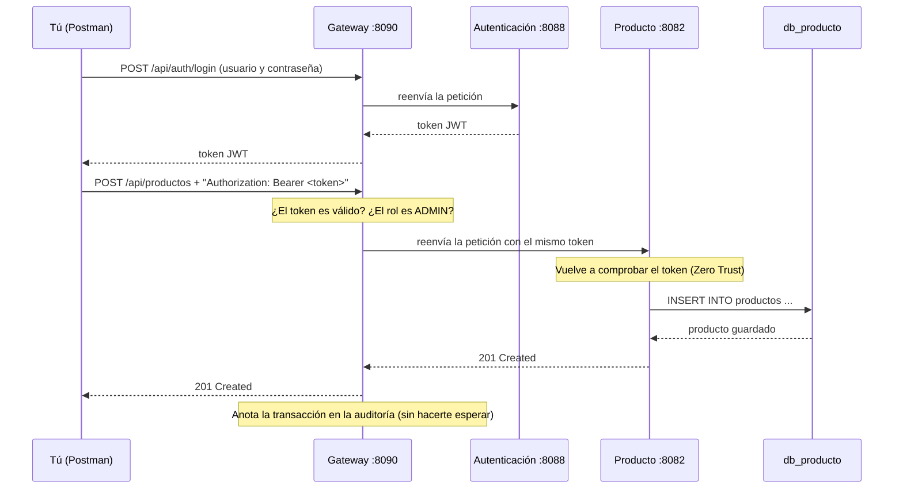
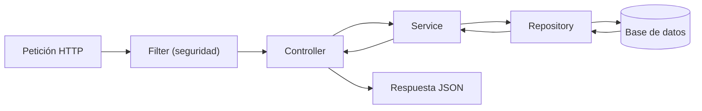

# Guía de Proyecto — TechRetail SOA

¡Bienvenido al equipo! 👋

Esta guía es para ti si acabas de llegar al proyecto y quieres entender **qué hace**, **cómo encenderlo** y **por dónde empezar a leer el código** sin perderte entre tantas carpetas.

No necesitas leerla de una sola vez. Te recomendamos este orden:

1. Lee la sección 1 (10 minutos) para tener el mapa en la cabeza.
2. Sigue la sección 2 con la terminal abierta, paso a paso.
3. Usa la sección 3 como ruta de estudio durante tus primeros días.

Si buscas datos técnicos exactos (versiones, tablas, todas las variables), están en el [Documento Técnico](Documento_Tecnico.md).

---

## 1. ¿Qué hace este proyecto?

TechRetail es una tienda de tecnología que vende por internet. En lugar de construir un único programa gigante que lo haga todo, el sistema está dividido en **varios programas pequeños**, cada uno con una sola responsabilidad. A cada uno lo llamamos **microservicio** (o simplemente "servicio").

Piensa en un centro comercial:

- Hay una **puerta de entrada con seguridad** por la que pasa todo el mundo.
- Dentro hay **tiendas independientes**, cada una con su propio almacén.
- Hay un **vigilante** que recorre las tiendas para comprobar que están abiertas.

Así funciona TechRetail.

### Los cuatro servicios que ya funcionan

| Servicio | Puerto | En una frase | Analogía |
|---|---|---|---|
| **Gateway** (`techretail-gateway`) | 8090 | Recibe todas las peticiones, comprueba quién eres y las envía al servicio correcto | La puerta de entrada con seguridad |
| **Autenticación** (`techretail-autenticacion`) | 8088 | Registra usuarios y, cuando haces login, te entrega un "pase" (token) | La oficina que entrega las credenciales |
| **Producto** (`techretail-producto`) | 8082 | Guarda el catálogo: productos, precios y categorías | El escaparate de la tienda |
| **Monitoreo** (`techretail-monitoreo`) | 8089 | Cada 30 segundos pregunta a los demás servicios "¿estás vivo?" y lo anota | El vigilante que hace rondas |

Un poco más de detalle de cada uno:

**Gateway.** Es la única puerta. Tú nunca llamas directamente a Producto o a Autenticación: llamas al Gateway en el puerto 8090 y él decide a quién reenviar la petición según la dirección (por ejemplo, todo lo que empieza por `/api/productos` va a Producto). Además, apunta en un registro cada petición que pasa por él: quién la hizo, a dónde iba y si salió bien. A eso lo llamamos **auditoría**.

**Autenticación.** Cuando haces login con usuario y contraseña, te devuelve un **token JWT**: un texto largo, firmado digitalmente, que dice "esta persona es X y tiene el rol Y". Lo guardas y lo envías en cada petición siguiente, como quien enseña su pase en la puerta.

**Producto.** Cualquiera puede **ver** el catálogo sin login. Pero solo un usuario con rol `ADMIN` puede **crear o modificar** productos y categorías.

**Monitoreo.** Llama periódicamente a la dirección `/actuator/health` de cada servicio y guarda si respondió (`UP`) o no (`DOWN`) y cuánto tardó. Solo `ADMIN` y `EMPLEADO` pueden consultar esos datos.

### Los seis servicios que aún están en construcción

`cliente`, `pedido`, `pago`, `inventario`, `notificacion` y `facturacion-sunat` ya existen como carpetas y arrancan, pero todavía no tienen lógica de negocio. Por ahora puedes ignorarlos.

### Tres ideas que verás por todas partes

**1. Roles.** Hay tres tipos de usuario:

- `ADMIN`: puede hacerlo todo.
- `EMPLEADO`: personal de la tienda.
- `CLIENTE`: un comprador.

Cada dirección de la API dice qué roles pueden usarla.

**2. Cada servicio tiene su propia base de datos.** Producto guarda sus datos en `db_producto`, Autenticación en `db_autenticacion`, y así con todos. Ningún servicio mira la base de datos de otro. Si necesitan información de otro, se la piden por la API.

**3. Doble control de seguridad.** El Gateway revisa el token, y **además** cada servicio lo vuelve a revisar por su cuenta. Así, aunque alguien intentara saltarse el Gateway y llamar directo a un servicio, tampoco podría entrar. A esto se le llama *Zero Trust* ("no confíes en nadie por defecto").

### El viaje de una petición

Así es como viaja una petición desde que la envías hasta que recibes la respuesta:



---

## 2. ¿Cómo levanto el proyecto?

Vamos a encender todo desde cero. Calcula unos 20–30 minutos la primera vez (Maven descarga muchas librerías). Las siguientes veces serán un par de minutos.

> [!NOTE]
> Los comandos están escritos para **PowerShell en Windows**. Si usas Linux o macOS, cambia `.\mvnw.cmd` por `./mvnw`.

### Paso 0 — Instala las herramientas

Solo necesitas tres cosas:

| Herramienta | Para qué | Cómo comprobar que la tienes |
|---|---|---|
| **JDK 21** (Java) | Compilar y ejecutar los servicios | `java -version` debe mostrar `21` |
| **Docker Desktop** | Levantar la base de datos y las herramientas de apoyo | `docker --version` |
| **Git** | Descargar el código | `git --version` |

**No necesitas instalar Maven.** Cada servicio trae su propio Maven dentro (el archivo `mvnw.cmd`).

Opcional, pero muy útil: **Postman**, para probar la API con clics en lugar de comandos.

### Paso 1 — Descarga el código

```powershell
git clone https://github.com/OD12042001/techretail-soa.git
cd techretail-soa
```

A partir de ahora, cuando digamos "la raíz del proyecto" nos referimos a esta carpeta `techretail-soa`.

### Paso 2 — Enciende la infraestructura con Docker

Asegúrate de que **Docker Desktop está abierto** y, desde la raíz del proyecto:

```powershell
docker compose up -d postgres rabbitmq jaeger
```

¿Qué acabas de encender?

- **postgres**: la base de datos. La primera vez crea automáticamente las 10 bases de datos del proyecto.
- **rabbitmq**: el sistema de mensajería. Aún no se usa, pero conviene tenerlo encendido.
- **jaeger**: una herramienta para ver gráficamente el recorrido de cada petición entre servicios.

La `-d` significa "en segundo plano": la terminal queda libre.

Comprueba que los tres contenedores están en marcha:

```powershell
docker compose ps
```

Deberías ver `techretail-postgres`, `techretail-rabbitmq` y `techretail-jaeger` con estado `running` (o `Up`).

> [!IMPORTANT]
> La base de datos escucha en el puerto **5433**, no en el 5432 habitual. Es intencionado: el 5432 lo usa otra instalación de PostgreSQL. Si te conectas con pgAdmin o DBeaver, usa `localhost:5433`, usuario `techretail`, contraseña `techretail123`.

### Paso 3 — Comprueba que todo compila (recomendado)

Antes de encender los servicios, ejecuta las pruebas de uno de ellos. Si pasan, sabes que tu Java y tu Maven funcionan:

```powershell
cd techretail-producto
.\mvnw.cmd test
cd ..
```

Al final debes ver `BUILD SUCCESS`. Las pruebas **no necesitan Docker**: usan una base de datos temporal en memoria.

> [!TIP]
> La primera ejecución tarda bastante porque descarga las dependencias. No te preocupes si ves muchas líneas de `Downloading...`.

### Paso 4 — Enciende los cuatro servicios

Cada servicio es un programa independiente, así que necesitas **cuatro terminales**, una por servicio. Ábrelas todas en la raíz del proyecto y ejecuta en cada una:

**Terminal 1 — Autenticación** (primero, porque es quien entrega los tokens):

```powershell
cd techretail-autenticacion
.\mvnw.cmd spring-boot:run
```

**Terminal 2 — Producto:**

```powershell
cd techretail-producto
.\mvnw.cmd spring-boot:run
```

**Terminal 3 — Monitoreo:**

```powershell
cd techretail-monitoreo
.\mvnw.cmd spring-boot:run
```

**Terminal 4 — Gateway** (el último, para que cuando arranque ya tenga a quién enviar las peticiones):

```powershell
cd techretail-gateway
.\mvnw.cmd spring-boot:run
```

¿Cómo sabes que un servicio arrancó bien? Busca una línea parecida a esta al final de su terminal:

```text
Started TechretailProductoApplication in 8.4 seconds
```

Deja las cuatro terminales abiertas. Si cierras una, ese servicio se apaga.

> [!NOTE]
> Al arrancar Autenticación por primera vez se crean tres usuarios de prueba, uno por rol. Los usaremos en el paso siguiente.

| Usuario | Contraseña | Rol |
|---|---|---|
| `admin@techretail.pe` | `Admin123!` | `ADMIN` |
| `empleado@techretail.pe` | `Empleado123!` | `EMPLEADO` |
| `cliente@techretail.pe` | `Cliente123!` | `CLIENTE` |

### Paso 5 — Prueba que funciona

Abre una **quinta terminal** (PowerShell). Todas las peticiones van al Gateway, en el puerto **8090**.

**5.1 — ¿El Gateway está vivo?**

```powershell
Invoke-RestMethod http://localhost:8090/actuator/health
```

Respuesta esperada: `status : UP`.

**5.2 — Mira el catálogo (no necesita login):**

```powershell
Invoke-RestMethod http://localhost:8090/api/productos/categorias
```

Verás las 5 categorías que vienen cargadas de serie (Laptops, Smartphones, Periféricos, Componentes y Accesorios).

**5.3 — Haz login como administrador y guarda el token:**

```powershell
$login = Invoke-RestMethod -Method Post -Uri http://localhost:8090/api/auth/login `
  -ContentType 'application/json' `
  -Body '{"usuario":"admin@techretail.pe","password":"Admin123!"}'

$login.token
```

Ese texto largo que aparece es tu token. La variable `$login` lo guarda para los siguientes comandos.

**5.4 — Crea un producto (solo ADMIN puede):**

```powershell
Invoke-RestMethod -Method Post -Uri http://localhost:8090/api/productos `
  -Headers @{ Authorization = "Bearer $($login.token)" } `
  -ContentType 'application/json' `
  -Body '{"nombre":"Mouse Gamer","descripcion":"RGB 16000 DPI","precio":89.90,"idCategoria":1,"stockReferencial":25}'
```

Si todo va bien, te devuelve el producto creado con su `id`.

**5.5 — Mira la auditoría** (lo que el Gateway ha ido anotando):

```powershell
Invoke-RestMethod -Uri "http://localhost:8090/api/auditoria?limite=5" `
  -Headers @{ Authorization = "Bearer $($login.token)" }
```

Verás tus últimas peticiones: el login, la consulta de categorías y la creación del producto.

**5.6 — Pregunta al vigilante cómo están los servicios:**

```powershell
Invoke-RestMethod -Uri http://localhost:8090/api/monitoreo/estado `
  -Headers @{ Authorization = "Bearer $($login.token)" }
```

> [!NOTE]
> Monitoreo hace su primera ronda 30 segundos después de arrancar; si la lista sale vacía, espera un poco. Es **normal** que los seis servicios en construcción aparezcan como `DOWN`: no los encendiste.

**5.7 — Ve el viaje de tus peticiones en Jaeger:**

Abre http://localhost:16686 en el navegador, elige `techretail-gateway` en el desplegable **Service** y pulsa **Find Traces**. Cada resultado muestra por qué servicios pasó una petición y cuánto tardó en cada uno.

> [!TIP]
> ¿Prefieres Postman? Salta a [Paso 5 alternativa — Prueba con Postman](#paso-5-alternativa--prueba-con-postman): importas la colección completa `docs/postman_collection/techretail-completa.json` y recorres los mismos casos con clics.

### Paso 5 alternativa — Prueba con Postman

Si prefieres una ventana con botones en vez de escribir comandos, esta sección es para ti. Postman es una aplicación gratuita que guarda tus peticiones HTTP y te deja repetirlas con un clic.

Todo lo que viene apunta al **Gateway**, en `http://localhost:8090`. Ese es el punto único de entrada: si algo funciona contra el Gateway, funciona en el proyecto.

#### 5A.1 — Importa la colección

Una **colección** es una carpeta de peticiones ya escritas. La nuestra está en `docs/postman_collection/`.

1. Abre Postman (descárgalo de `postman.com/downloads` o usa la versión web).
2. Si te ofrece crear una cuenta, puedes saltarlo con **Continue without an account**.
3. Arriba a la izquierda, haz clic en **Import**.
4. Arrastra el archivo `techretail-completa.json` a la ventana (o usa **files** para buscarlo).
5. Haz clic en **Import**.
6. En la barra lateral izquierda, dentro de **Collections**, aparece **TechRetail SOA - Completa**. Haz clic para desplegarla.

#### 5A.2 — Conoce la pantalla antes de tocar nada

| Zona | Qué es |
|---|---|
| Barra lateral izquierda | La colección y sus carpetas: `01 Autenticacion`, `02 Catalogo de productos`, `03 Monitoreo`, `04 Auditoria`, `05 Seguridad` |
| Arriba al centro | El método (`GET`, `POST`, `PUT`), la URL y el botón azul **Send** |
| Debajo de la URL | Las pestañas de la petición: **Params**, **Authorization**, **Headers**, **Body**, **Scripts**, **Settings** |
| Panel derecho | La respuesta: código de estado, tiempo, y las pestañas **Body**, **Cookies**, **Headers**, **Test Results** |

**Regla de oro para leer un error:**

| Código | Qué significa | Dónde mirar |
|---|---|---|
| **401** | No sé quién eres | Falta el token, está vencido o mal pegado |
| **403** | Sé quién eres, pero no puedes | Tu rol no alcanza para esa ruta |
| **400** | Tu petición está mal armada | El body o un parámetro |
| **404** | Esa URL o ese id no existe | La ruta o el `{id}` |
| **409** | Ese dato ya existe | El usuario que intentas registrar |

#### 5A.3 — Las variables: el cajón donde se guarda el token

La colección usa **variables** para no repetir datos. Cuando ves `{{baseUrl}}` o `{{adminToken}}`, Postman los reemplaza por su valor al enviar.

1. Haz clic en el **nombre de la colección** (no en una petición).
2. Se abre una vista con las pestañas **Overview**, **Authorization**, **Scripts**, **Variables**.
3. Haz clic en **Variables**.

| Variable | Valor inicial | Para qué |
|---|---|---|
| `baseUrl` | `http://localhost:8090` | La dirección del Gateway |
| `adminToken` | *(vacío)* | Token del usuario ADMIN |
| `empleadoToken` | *(vacío)* | Token del usuario EMPLEADO |
| `clienteToken` | *(vacío)* | Token del usuario CLIENTE |
| `productoId` | `4` | Id del producto que crees |
| `categoriaId` | `1` | Id de una categoría existente |

> [!IMPORTANT]
> Si una variable queda vacía, la cabecera se envía como `Bearer ` y el Gateway responde **401**. Antes de culpar al código, mira esta tabla.

#### 5A.4 — Tu primera petición: un GET público

Las peticiones públicas **no llevan token**. El Gateway las deja pasar sin mirar credenciales.

1. Despliega `02 Catalogo de productos` y haz clic en **P4 - Catalogo publico**.
2. Verifica arriba: método **GET** y URL `{{baseUrl}}/api/productos`.
3. Ve a la pestaña **Authorization** y confirma que dice **No Auth**. Si dice otra cosa, cámbiala a **No Auth**.
4. Pulsa **Send**.
5. En el panel derecho verás **200 OK** y una lista JSON.

```json
[
  {
    "id": 1,
    "nombre": "Mouse Gamer RGB",
    "descripcion": "16000 DPI",
    "precio": 89.90,
    "idCategoria": 1,
    "categoria": "Laptops",
    "stockReferencial": 25,
    "disponible": true,
    "fechaCreacion": "2026-05-10T18:22:31"
  }
]
```

> [!NOTE]
> Un **GET** no lleva body: la pestaña **Body** queda en **none**. El body es para `POST` y `PUT`.

Prueba también **P5** (con filtros `?q=monitor&soloDisponibles=true`) y la ruta pública de categorías: `{{baseUrl}}/api/productos/categorias` devuelve las 5 categorías cargadas de serie.

#### 5A.5 — El login: un POST público que devuelve el token

1. Despliega `01 Autenticacion` y abre **P1 - Login ADMIN**.
2. Arriba: método **POST**, URL `{{baseUrl}}/api/auth/login`.
3. Pestaña **Body** → marca el círculo **raw** → en el desplegable de la derecha elige **JSON**.
4. Escribe el cuerpo:

```json
{
  "usuario": "admin@techretail.pe",
  "password": "Admin123!"
}
```

5. Pulsa **Send**. Debes ver **200 OK**:

```json
{
  "token": "eyJhbGciOiJIUzI1NiJ9.eyJzdWIiOiJhZG1pbi...",
  "tipo": "Bearer",
  "expiraEn": 3600,
  "rol": "ADMIN",
  "idUsuario": 1,
  "nombre": "Administrador TechRetail"
}
```

`expiraEn` son **segundos**: 3600 = 60 minutos de vida. Pasado ese tiempo, el token deja de servir y hay que repetir el login.

#### 5A.6 — Guarda el token automáticamente

No hace falta copiar y pegar. La petición **P1** ya trae un script que lo hace:

1. Con **P1** abierta, ve a la pestaña **Scripts**.
2. Haz clic en **Post-response** (en versiones anteriores se llama **Tests**).
3. Verás esta línea:

```javascript
pm.collectionVariables.set('adminToken', pm.response.json().token);
```

Se lee así: *"guarda en la variable `adminToken` el campo `token` de la respuesta"*. Se ejecuta solo después de cada **Send**.

**Alternativa manual** (útil para entender qué pasa): selecciona el valor de `token` **sin las comillas**, ve a la colección → **Variables**, pégalo en `adminToken` y guarda con `Ctrl + S`.

> [!TIP]
> Para comprobar que el token viaja de verdad, abre la **Console** (abajo a la izquierda, icono de terminal) y mira la petición enviada: debe aparecer `Authorization: Bearer eyJ...`.

#### 5A.7 — Un POST privado: crear un producto (solo ADMIN)

1. Abre **P9 - Crear producto**.
2. Arriba: método **POST**, URL `{{baseUrl}}/api/productos`.
3. Pestaña **Authorization** → en **Type** elige **Bearer Token**.
4. En el campo **Token** escribe exactamente:

```text
{{adminToken}}
```

> [!CAUTION]
> Escribe **solo** `{{adminToken}}`. No escribas `Bearer` delante: Postman lo agrega por su cuenta. Si escribes `Bearer {{adminToken}}`, la cabecera sale como `Bearer Bearer eyJ...` y recibirás un **401**.

5. Pestaña **Body** → **raw** → **JSON**:

```json
{
  "nombre": "Teclado Mecanico Keychron K8 Pro",
  "descripcion": "TKL, switches Gateron Brown, inalambrico",
  "precio": 549.90,
  "idCategoria": 3,
  "stockReferencial": 25
}
```

6. Pulsa **Send**. Debes ver **201 Created**, la cabecera `Location` y el producto con su `id`. El script guarda ese id en `productoId` para las peticiones siguientes.

Qué significa cada campo:

| Campo | Obligatorio | Regla |
|---|---|---|
| `nombre` | Sí | Hasta 150 caracteres |
| `descripcion` | No | Texto libre |
| `precio` | Sí | Mayor o igual a 0.01, máximo 2 decimales |
| `idCategoria` | Sí | Debe existir (1 a 5 de serie) |
| `stockReferencial` | Sí | 0 o más |
| `disponible` | No | Si lo omites, queda en `true` |

> [!NOTE]
> No existe `DELETE`. Para "borrar" un producto se hace un **PUT** con `"disponible": false`: es una baja lógica y el producto deja de aparecer al filtrar con `soloDisponibles=true`.

#### 5A.8 — Quién puede hacer qué

| Acción | ADMIN | EMPLEADO | CLIENTE | Sin token |
|---|---|---|---|---|
| Leer catálogo y categorías | ✅ | ✅ | ✅ | ✅ |
| Crear o editar producto / categoría | ✅ | ❌ 403 | ❌ 403 | 401 |
| Ver estado e historial de monitoreo | ✅ | ✅ | ❌ 403 | 401 |
| Ver auditoría del BUS | ✅ | ✅ | ❌ 403 | 401 |
| Registro y login | ✅ | ✅ | ✅ | ✅ |

Los tres usuarios de prueba se crean solos al arrancar Autenticación:

| Usuario | Contraseña | Rol |
|---|---|---|
| `admin@techretail.pe` | `Admin123!` | `ADMIN` |
| `empleado@techretail.pe` | `Empleado123!` | `EMPLEADO` |
| `cliente@techretail.pe` | `Cliente123!` | `CLIENTE` |

Para ver un **403** en vivo: ejecuta **P8a - Login CLIENTE** (guarda `clienteToken`), abre **P8b** y pulsa **Send**. El token es válido, pero el rol no alcanza.

#### 5A.9 — Los errores también se prueban

Media nota está en demostrar que el sistema **rechaza** lo que debe rechazar. Estas peticiones ya vienen preparadas:

| Petición | Qué demuestra | Esperado |
|---|---|---|
| `P2 - Login credenciales invalidas` | No filtra si el usuario existe | 401 `Credenciales invalidas` |
| `P7 - Escritura sin token` | El BUS corta antes de enrutar | 401 |
| `P8b - Escritura con rol CLIENTE` | Token válido, rol insuficiente | 403 |
| `P12 - Validacion de entrada` | Precio negativo rechazado | 400 |
| `P14 - Historial con limite invalido` | Parámetro fuera de rango | 400 (no 401) |
| `P17 - Token alterado` | Firma manipulada | 401 |
| `P6 - Detalle inexistente` | Id que no existe | 404 |

La diferencia entre 401 y 403 es la pregunta clásica: **401 = no sé quién eres**; **403 = sé quién eres, pero no tienes permiso**.

#### 5A.10 — Ejecuta toda la colección de una vez

1. Haz clic en los tres puntos **⋯** junto al nombre de la colección.
2. Elige **Run collection**.
3. Pulsa **Run TechRetail SOA - Completa**.
4. Mira la pestaña **Test Results**: cada punto verde es una prueba que pasó.

> [!IMPORTANT]
> El orden importa: **P1** y **P8a** llenan los tokens, y **P9** llena `productoId`. Si corres una petición suelta antes del login, verás 401.

> [!NOTE]
> **P3 - Registro de cliente** usa un usuario fijo: la segunda vez responde **409** porque ya existe. Es el comportamiento correcto; si quieres volver a ver el 201, cambia el `usuario` del body por uno nuevo.

#### 5A.11 — Problemas típicos en Postman

| Lo que ves | Causa | Solución |
|---|---|---|
| 401 con token "puesto" | La variable está vacía | Repite **P1** o pega el token en **Variables** |
| 401 después de un rato | El token venció (60 min) | Repite **P1** |
| 401 con `Bearer Bearer ...` | Escribiste `Bearer` en el campo Token | Deja solo `{{adminToken}}` |
| 400 con body vacío | La pestaña **Body** quedó en **none** | Elige **raw** → **JSON** |
| `Could not send request` | El Gateway no está encendido | Revisa la terminal del Gateway (puerto 8090) |
| 502 o error de conexión en `/api/clientes` | Ese servicio aún no está implementado | Es esperado: solo 4 servicios funcionan |

#### 5A.12 — Comprueba la segunda capa de seguridad

El proyecto no confía solo en el Gateway: cada servicio valida el token por su cuenta. Para verlo, las peticiones **P18a** y **P18b** van **directo** a Producto, sin pasar por el BUS:

- `P18a` → `GET http://localhost:8082/api/productos` → **200** (la lectura es pública en ambas capas).
- `P18b` → `POST http://localhost:8082/api/productos` sin token → **401** (el servicio se defiende solo).

Eso es *Zero Trust*: aunque alguien salte el BUS, el servicio igual exige credenciales.

### Paso 6 — Apaga todo

1. En cada una de las cuatro terminales de los servicios, pulsa `Ctrl + C`.
2. Desde la raíz del proyecto, apaga los contenedores:

```powershell
docker compose down
```

Tus datos se conservan para la próxima vez.

> [!CAUTION]
> `docker compose down -v` (con `-v`) **borra la base de datos por completo**. Úsalo solo si quieres empezar de cero.

### Si algo sale mal

| Lo que ves | Qué significa | Cómo arreglarlo |
|---|---|---|
| `Connection refused` o `Connection to localhost:5433 refused` al arrancar un servicio | La base de datos no está encendida | Abre Docker Desktop y repite el paso 2 |
| `database "db_xxx" does not exist` | El volumen de Docker se creó antes de que existiera esa base | `docker compose down -v` y luego `docker compose up -d postgres rabbitmq jaeger` (esto borra los datos) |
| `Port 8082 was already in use` | Ya hay algo usando ese puerto (quizá el mismo servicio en otra terminal) | Cierra la otra terminal o el proceso que lo ocupa |
| `401 Unauthorized` | No enviaste token, está mal escrito o caducó (dura 60 minutos) | Repite el login (paso 5.3) |
| `403 Forbidden` | El token es válido, pero tu rol no tiene permiso | Haz login con un usuario que tenga el rol necesario |
| Una petición al Gateway tarda y falla con error de conexión | El servicio de destino no está encendido | Revisa que su terminal siga abierta y sin errores |
| `mvnw.cmd` no se reconoce | Estás en la raíz del proyecto | Entra antes en la carpeta del servicio con `cd techretail-xxx` |

---

## 3. ¿Cómo empiezo a leer el código?

Esta es la parte que más asusta al principio, pero con un orden claro se vuelve sencilla. La idea es **seguir el camino que recorren los datos**, del más simple al más complejo.

### 3.1 Antes de abrir código: cómo está organizada cada carpeta

Todos los servicios siguen la misma estructura. Si entiendes uno, entiendes todos:

```text
techretail-producto/
├── pom.xml                         ← lista de librerías que usa el servicio
├── mvnw.cmd                        ← el Maven incluido (para compilar y arrancar)
└── src/
    ├── main/
    │   ├── java/com/techretail/techretail_producto/
    │   │   ├── TechretailProductoApplication.java   ← el "main": aquí arranca todo
    │   │   ├── producto/           ← la lógica del negocio (catálogo)
    │   │   └── seguridad/          ← la comprobación del token
    │   └── resources/
    │       ├── application.properties              ← configuración (puerto, base de datos...)
    │       └── db/migration/       ← scripts SQL que crean las tablas
    └── test/                       ← las pruebas automáticas
```

Dos detalles que confunden al principio:

- Los paquetes llevan **guion bajo**: `techretail_producto`. No es un error, viene así de la plantilla original. No lo cambies.
- El código está agrupado **por tema**, no por tipo. Todo lo del catálogo (controller, service, repository...) vive junto en la carpeta `producto/`.

### 3.2 Mini glosario: las piezas que verás en todos los servicios

| Pieza | Qué hace | Analogía en un restaurante |
|---|---|---|
| **Controller** | Recibe la petición HTTP y devuelve la respuesta | El camarero que toma el pedido |
| **DTO** (`*Request`, `*Response`) | Define qué datos entran y qué datos salen | La comanda escrita |
| **Service** | Aplica las reglas del negocio | El cocinero que prepara el plato |
| **Repository** | Lee y escribe en la base de datos | La despensa |
| **Entity** | Una clase Java que representa una fila de una tabla | Un ingrediente etiquetado en la despensa |
| **Migración SQL** (`V1__...sql`) | Crea las tablas | El plano de la despensa |
| **ExceptionHandler** | Convierte los errores en respuestas claras (400, 404...) | El encargado que da las malas noticias con amabilidad |
| **SecurityConfig** | Decide qué rutas son públicas y cuáles exigen rol | La lista de la puerta |
| **Filter** | Código que se ejecuta *antes* de llegar al Controller | El portero que revisa el pase |

La regla de oro: **una petición siempre entra por el Controller, pasa por el Service y llega al Repository**. Las respuestas hacen el camino de vuelta.



### 3.3 La ruta de lectura

Sigue las etapas en orden. Cada una se apoya en la anterior.

#### Etapa 1 — Producto: el CRUD más sencillo (empieza aquí)

**Por qué primero:** es un catálogo clásico (crear, leer, actualizar). No hay lógica rara, así que puedes concentrarte en entender cómo se conectan las piezas.

Abre los archivos en este orden, todos dentro de `techretail-producto/src/main/java/com/techretail/techretail_producto/producto/`:

1. **`ProductoController.java`** — Empieza por aquí. Fíjate en las anotaciones:
   - `@RequestMapping("/api/productos")` dice la dirección base.
   - `@GetMapping`, `@PostMapping` y `@PutMapping` dicen qué método atiende cada tipo de petición.
   - Verás que el controller casi no hace nada: recibe los datos y llama al servicio. Así debe ser.
2. **`ProductoRequest.java`** y **`ProductoResponse.java`** — Qué datos llegan y qué datos salen. En el `Request` mira las anotaciones de validación (`@NotBlank`, `@DecimalMin`, `@Digits`): son las reglas que hacen que una petición mal formada devuelva un `400`.
3. **`ProductoService.java`** — Aquí está la lógica. Por ejemplo, `crear()` comprueba que la categoría exista antes de guardar el producto. Mira también cómo `listar()` va añadiendo filtros según los parámetros que lleguen.
4. **`ProductoRepository.java`** — ¡Sorpresa! Es una interfaz casi vacía. Spring Data JPA genera automáticamente los métodos `save`, `findById`, `findAll`... No hace falta escribir SQL.
5. **`Producto.java`** y **`Categoria.java`** — Las entidades. Cada atributo corresponde a una columna de la tabla (`@Column`, `@ManyToOne`...).
6. **`src/main/resources/db/migration/V1__create_tables.sql`** y **`V2__seed_categorias.sql`** — Las tablas reales y las 5 categorías iniciales. Compara las columnas con los atributos de la entidad: deben coincidir exactamente, o el servicio no arranca.
7. **`ApiExceptionHandler.java`** — Cómo un `ProductoNoEncontradoException` se convierte en un `404` con un JSON claro.

> [!TIP]
> **Ejercicio:** sigue mentalmente una petición `POST /api/productos` con un `idCategoria` que no existe. ¿En qué archivo se detecta el problema? ¿En cuál se convierte en `404`? Si sabes responder, dominas la etapa 1.

#### Etapa 2 — Seguridad: cómo se comprueba el token

**Por qué ahora:** ya sabes cómo llega una petición al Controller. Ahora verás qué pasa **antes**, en la puerta.

Abre `techretail-producto/.../seguridad/` en este orden:

1. **`SecurityConfig.java`** — La lista de la puerta. Léela de arriba abajo como si fuera texto:
   - `GET /api/productos/**` → `permitAll()` (cualquiera).
   - El resto de `/api/productos/**` → `hasRole(ADMIN)`.
   - Al final verás `addFilterAfter(new JwtAuthenticationFilter(...))`: ahí se instala el portero.
2. **`JwtAuthenticationFilter.java`** — El portero. Mira la cabecera `Authorization`. Si no hay token, deja pasar (luego `SecurityConfig` decidirá si la ruta lo exigía). Si hay token pero es inválido, corta con `401`. Si es válido, apunta quién eres y con qué rol.
3. **`JwtService.java`** — El método `validar()` comprueba la firma, quién emitió el token, la fecha de caducidad y el rol.
4. **`Rol.java`** — Los tres roles posibles.
5. **`RestAuthenticationEntryPoint.java`** y **`RestAccessDeniedHandler.java`** — Escriben las respuestas `401` y `403` en formato JSON.

> [!NOTE]
> Encontrarás este mismo paquete de seguridad, casi idéntico, en Monitoreo y en el Gateway. Es intencionado: cada servicio es independiente y no comparte código con los demás. Si lo entiendes una vez, lo entiendes en los tres.

#### Etapa 3 — Autenticación: dónde nace el token

**Por qué ahora:** en la etapa 2 viste cómo se **comprueba** un token. Ahora verás cómo se **fabrica**.

En `techretail-autenticacion/src/main/java/com/techretail/techretail_autenticacion/`:

1. **`auth/AuthController.java`** — Dos rutas: `/registro` y `/login`. Mismo patrón que en Producto.
2. **`auth/AuthService.java`** — El corazón del servicio:
   - `registrar()` guarda la contraseña cifrada con **BCrypt** (nunca en texto plano).
   - `autenticar()` compara la contraseña y, si es correcta, pide un token. Fíjate en el detalle del "hash señuelo": aunque el usuario no exista, se hace el mismo cálculo, para que nadie pueda averiguar qué usuarios existen midiendo el tiempo de respuesta.
3. **`usuario/Usuario.java`** y **`usuario/UsuarioRepository.java`** — La entidad y el repositorio, igual que en Producto.
4. **`security/JwtService.java`** — Aquí está `emitir()`, que fabrica y firma el token. Compáralo con el `validar()` que viste en la etapa 2: uno firma y el otro comprueba la firma.
5. **`auth/DemoUsuarioSeeder.java`** — Crea los tres usuarios de prueba al arrancar.

#### Etapa 4 — Gateway: la puerta de entrada

**Por qué ahora:** ya conoces los servicios a los que el Gateway reenvía las peticiones. Ahora entenderás cómo las reparte y cómo las registra.

En `techretail-gateway/`:

1. **`src/main/resources/application.properties`** — Empieza por la configuración, no por el código. Busca las líneas `spring.cloud.gateway.server.webmvc.routes[...]`: cada bloque dice "lo que empiece por esta ruta, envíalo a este puerto". El enrutamiento se hace solo con configuración.
2. **`config/SecurityConfig.java`** — La lista de la puerta de todo el sistema: qué rol necesita cada ruta.
3. **`security/JwtAuthenticationFilter.java`** — El mismo portero que ya conoces de la etapa 2.
4. **`audit/AuditFilter.java`** — Se ejecuta en cada petición, deja que se procese y, al terminar, prepara una anotación con quién, qué, a dónde y con qué resultado.
5. **`audit/AuditPublisher.java`** y **`config/AuditAsyncConfig.java`** — La clave: la anotación se guarda **en otro hilo**, sin hacer esperar al usuario. Si la base de datos va lenta o falla, el usuario ni se entera.
6. **`audit/AuditLogRepository.java`** — Aquí no hay JPA: usa `JdbcTemplate` con SQL escrito a mano. Es otra forma válida de acceder a la base de datos.
7. **`audit/MonitoreoAuditoriaController.java`** — Las rutas `/api/auditoria` y `/api/auditoria/resumen` para consultar el registro.

> [!NOTE]
> El controlador de auditoría se llama `MonitoreoAuditoriaController`, pero atiende `/api/auditoria`, no `/api/monitoreo`. Es porque todo lo que empieza por `/api/monitoreo` el Gateway lo reenvía al servicio de Monitoreo antes de mirar sus propios controladores.

#### Etapa 5 — Monitoreo: tareas que se ejecutan solas

**Por qué al final:** introduce algo nuevo. Aquí el código no se ejecuta porque llegue una petición, sino porque **pasa el tiempo**.

En `techretail-monitoreo/`:

1. **`src/main/resources/application.properties`** — La lista de servicios a vigilar (`techretail.monitoreo.servicios[...]`) y cada cuánto tiempo.
2. **`salud/HealthCheckScheduler.java`** — La anotación `@Scheduled` hace que el método se ejecute solo cada 30 segundos. Es el despertador del vigilante.
3. **`salud/HealthCheckService.java`** — Recorre la lista de servicios, pregunta a cada uno y guarda el resultado. Si uno falla, lo anota como `DOWN` y sigue con el siguiente.
4. **`salud/HttpHealthProbe.java`** — Hace la llamada HTTP real y decide si la respuesta es `UP` o `DOWN`.
5. **`salud/MonitoreoLogRepository.java`** — Guarda y consulta el historial.
6. **`salud/MonitoreoController.java`** — Las rutas `/api/monitoreo/estado` e `/api/monitoreo/historial`.

#### Etapa 6 — Las pruebas: documentación que se puede ejecutar

Las pruebas son la mejor forma de entender **qué debe hacer** el código, porque cada una describe un caso concreto con su resultado esperado. Sus nombres están escritos como frases en español.

| Para entender... | Lee esta prueba |
|---|---|
| Todo lo que hace la API del catálogo | `ProductoControllerTests` (Producto) |
| Quién puede hacer qué en el catálogo | `ProductoSeguridadTests` (Producto) |
| Las reglas de negocio sin base de datos | `ProductoServiceTests` (Producto) |
| Registro y login | `AuthControllerTests` (Autenticación) |
| Cómo se valida un token | `JwtServiceTests` (Autenticación) |
| Que la auditoría no hace esperar | `AuditoriaAsincronaTests` (Gateway) |
| Los casos `UP` y `DOWN` de la sonda | `HttpHealthProbeTests` (Monitoreo) |

Por ejemplo, un nombre como `crearConCategoriaInexistenteDevuelve404` ya te explica la regla sin leer una sola línea más.

Para ejecutar una sola clase de pruebas:

```powershell
cd techretail-producto
.\mvnw.cmd test -Dtest=ProductoControllerTests
```

### 3.4 Consejos para no frustrarte

- **No intentes leerlo todo.** Con las etapas 1 y 2 ya puedes contribuir en Producto.
- **Sigue una petición concreta**, no un archivo entero. Pregúntate: "si llamo a esta ruta, ¿qué método se ejecuta después?".
- **Usa "Ir a la definición"** de tu editor (`F12` en VS Code, `Ctrl + clic` en IntelliJ) para saltar de una clase a otra.
- **Ejecuta y observa.** Pon un punto de interrupción (*breakpoint*) en el Controller, lanza una petición desde Postman y avanza paso a paso.
- **Si una prueba falla, léela.** Su nombre te dice qué regla se ha roto.
- **Ignora por ahora** los seis servicios en construcción. Cuando toque trabajar en ellos, seguirán el mismo patrón que Producto.

### 3.5 Reglas del proyecto que conviene saber desde el primer día

- **Primero la prueba, luego el código (TDD).** Antes de añadir una funcionalidad se escribe una prueba que falla; después, el código que la hace pasar.
- **Nunca edites una migración ya aplicada** (`V1__...sql`). Si necesitas cambiar una tabla, crea una nueva (`V3__...sql`).
- **La configuración es `.properties`**, no YAML. No pegues sintaxis YAML en esos archivos.
- **Los comandos de Maven se ejecutan dentro de cada servicio**, nunca en la raíz.
- **Nunca subas secretos reales** al repositorio. Los valores que hay son solo para desarrollo local.

---

¿Te has atascado en algo que esta guía no explica? Esa es una pista de que a la guía le falta una sección: ¡propón la mejora!
