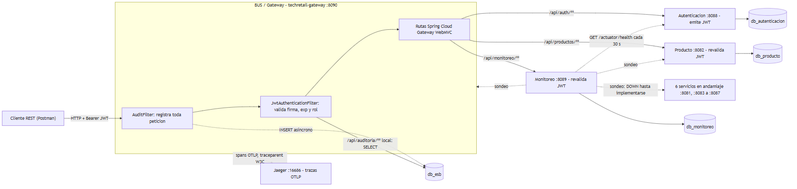
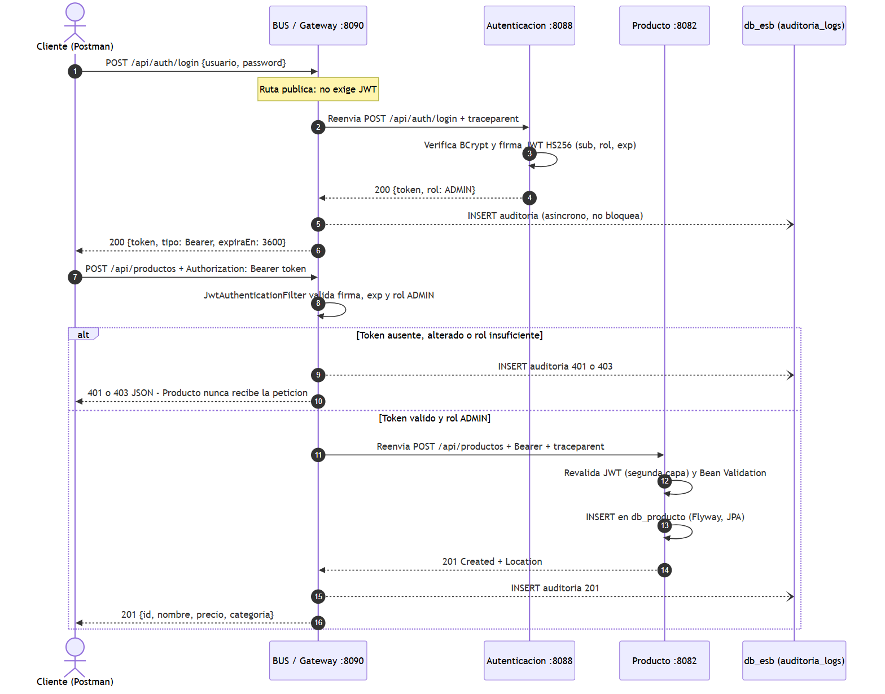

# Implementación de una Arquitectura SOA para TechRetail S.A.
## Avance 3 (Semana 15) — Implementación Parcial

- **Curso:** Arquitectura Orientada al Servicio (`100000SI84`)
- **Docente:** Calderón Chuquillanqui, Anthony Vidal
- **Equipo:** Grupo 1 — *[COMPLETAR: Apellidos, Nombres]*
- **Stack principal:** Java 21 · Spring Boot 4.1.1 · PostgreSQL 16 · OpenTelemetry/Jaeger · OWASP ZAP 2.17.0
- **Fecha de entrega:** 16 de noviembre de 2026

---

## 1. Resumen Ejecutivo y Decisiones de Diseño

Paso del diseño arquitectónico (Avance 2) a **código ejecutable y verificado** en cuatro servicios independientes:

1. **Database per Service real:** cada módulo administra su propio esquema PostgreSQL con **Flyway** (`ddl-auto=validate`). Cero consultas cruzadas entre tablas; toda integración ocurre por HTTP.
2. **Seguridad stateless en dos capas (JWT HS256):**
   - **Capa 1 (BUS `:8090`):** rechaza peticiones sin token válido y aplica reglas de rol por ruta antes de enrutar.
   - **Capa 2 (Servicios `:8082`, `:8089`):** cada servicio revalida el JWT de forma autónoma para impedir *bypass* por puerto directo.
3. **Auditoría asíncrona desacoplada:** `AuditFilter` registra cada transacción (incluidos rechazos `401`/`403`/`400`) en `db_esb.auditoria_logs` mediante un ejecutor acotado sin bloquear al cliente.

---

## 2. Stack Técnico Verificado

| Capa | Tecnología | Aplicación en TechRetail SOA |
|---|---|---|
| **Lenguaje y Runtime** | Java 21 + Maven Wrapper (`mvnw`) | 10 proyectos Maven independientes (sin reactor raíz) |
| **Framework Base** | Spring Boot 4.1.1 (`spring-boot-starter-webmvc`) | Starters modulares de Boot 4 sobre Tomcat embebido |
| **Gateway / BUS** | Spring Cloud Gateway Server WebMVC + `JdbcTemplate` | Enrutamiento servlet síncrono y auditoría en `db_esb` |
| **Seguridad** | Spring Security + `jjwt` 0.11.5 (HS256) + BCrypt (costo 12) | Emisión en Autenticación; validación en BUS, Producto y Monitoreo |
| **Datos y Migraciones** | PostgreSQL 16 (`:5433`) + Flyway + H2 (`MODE=PostgreSQL`) | Esquema versionado en `V1`/`V2`; tests sin depender de Docker |
| **Observabilidad** | Actuator + OpenTelemetry (`OTLP`) + Jaeger 1.62.0 | Propagación W3C `traceparent` y métricas de latencia por span |
| **Seguridad Dinámica** | OWASP ZAP 2.17.0 (`zap-api-scan.py`) + OpenAPI 3.0 | Escaneo activo autenticado contra las 12 operaciones del BUS |

---

## 3. Servicios Implementados en el Avance 3

| Módulo | Puerto | Base de Datos | Endpoints Clave | Regla de Acceso |
|---|---|---|---|---|
| `techretail-autenticacion` | `8088` | `db_autenticacion` | `POST /api/auth/registro` `POST /api/auth/login` | Público (BCrypt costo 12; aprovisiona usuarios demo por rol) |
| `techretail-producto` | `8082` | `db_producto` | `GET /api/productos/**` `POST`, `PUT /api/productos/**` | Lectura pública; escritura y baja lógica (`disponible=false`) solo `ADMIN` |
| `techretail-monitoreo` | `8089` | `db_monitoreo` | `GET /api/monitoreo/estado` `GET /api/monitoreo/historial` | `ADMIN`, `EMPLEADO` (sondea `/actuator/health` cada 30 s) |
| `techretail-gateway` | `8090` | `db_esb` | Proxy `/api/**` y `/ws/**` `GET /api/auditoria`, `/resumen` | Punto único de entrada; validación JWT central y auditoría |

> Los 6 módulos restantes (`cliente`, `pedido`, `pago`, `inventario`, `notificacion`, `facturacion-sunat`) cuentan con configuración, BD y migración Flyway inicial como andamiaje para la entrega final.

---

## 4. Orquestación Parcial — Arquitectura de Integración

- **Mediación por el BUS:** el cliente solo conversa con `:8090`; el BUS autentica, autoriza, enruta y audita.
- **Sondeo activo:** `techretail-monitoreo` invoca directamente `/actuator/health` de los 9 servicios cada 30 s (`HttpClient`, timeout 2 s) y exige `"status":"UP"` en el cuerpo JSON.

---

## 5. Orquestación Parcial — Secuencia Gateway → Auth → Producto

- **Desacoplamiento en ejecución:** Producto verifica la firma HS256 con `JWT_SECRET` sin invocar a Autenticación en cada request.

---

## 6. Observabilidad (4 Frentes) y Registro de Servicios

**Observabilidad complementaria (§2.6):**
- **Actuator (`/actuator/health`):** estado vivo de cada proceso.
- **OpenTelemetry + Jaeger (`:16686`):** trazas distribuidas W3C `traceparent` (ej. traza `3f196553…` en login: 615 ms en Auth de 636 ms totales en Gateway).
- **Monitoreo persistente (`db_monitoreo`):** historial de disponibilidad y latencia (`UP` en los 3 activos, `DOWN` en los 6 en andamiaje).
- **Auditoría de negocio (`db_esb`):** quién invocó qué ruta, hacia qué servicio destino y con qué código HTTP real.

**Registro de Servicios (§5):**
- **Actual (REST):** publicación declarativa en la tabla de rutas del BUS (variables `SERVICIO_<NOMBRE>_URL`) y contrato `docs/zap/openapi-gateway.yaml` (12 operaciones).
- **Evolución (UDDI):** endpoints propuestos `POST/GET /api/registro/servicios` (*Publish / Find / Bind*).

---

## 7. Pruebas Automatizadas y Manuales (Postman)

**1. Suite automatizada JUnit + Spring Boot Test (100 % en verde):**

| Módulo | Tests | Cobertura principal | Estado |
|---|---|---|---|
| `techretail-autenticacion` | 26 | Registro, login, firma/expiración JWT, BCrypt, normalización | `BUILD SUCCESS` |
| `techretail-producto` | 37 | CRUD catálogo, filtros, roles, Bean Validation, Tomcat error dispatch | `BUILD SUCCESS` |
| `techretail-gateway` | 27 | Enrutamiento, bloqueo 401/403 previo al destino, auditoría asíncrona | `BUILD SUCCESS` |
| `techretail-monitoreo` | 25 | Sonda HTTP (`UP`/`DOWN`/timeout), persistencia, límites, seguridad | `BUILD SUCCESS` |
| **Total implementados** | **115** | **+ 12 tests en los 6 módulos de andamiaje = 127 tests totales** | **0 fallos** |

**2. Pruebas manuales en Postman (`docs/postman_collection/techretail-avance3.json`):**
- **18 casos numerados (21 peticiones)** contra `:8090`: login (`P1`/`P2`), registro (`P3`), catálogo público (`P4`-`P6`), rechazos `401`/`403` (`P7`, `P8`, `P17`), alta/edición/baja lógica (`P9`-`P11`), validación `400` (`P12`, `P14`), monitoreo (`P13`), auditoría (`P15`, `P16`) y defensa en segunda capa directa al puerto `8082` (`P18`).

---

## 8. Escáner de Vulnerabilidades — OWASP ZAP 2.17.0

- **Método:** `zap-api-scan.py` en Docker contra `openapi-gateway.yaml` (12 operaciones en `:8090`), inyectando `Authorization: Bearer <adminToken>` para auditar endpoints protegidos.
- **Superficie explorada:** 50 variantes de endpoints (100 % JSON; 66 % rechazadas con `4xx` ante ataques).

| Nivel de Riesgo | Alertas | Resumen Ejecutivo |
|---|---|---|
| **Alto (`High`)** | **0** | Cero vulnerabilidades de inyección SQL, XSS, Path Traversal o SSRF |
| **Medio (`Medium`)** | **0** | Sin exposición de credenciales, sesiones ni trazas de pila (*stack traces*) |
| **Bajo (`Low`)** | **2** | `100000` (3 respuestas `500` por duplicados en fuzzing) y `90004` (cabecera CORP) |
| **Informativo (`Info`)** | **2** | `100000` (48 rechazos `4xx` esperados) y `10049` (`Cache-Control: no-store`) |

---

## 9. Clasificación de Alertas ZAP y Mitigación

| Alerta (Regla / CWE) | Nivel | Diagnóstico Técnico | Mitigación / Decisión |
|---|---|---|---|
| **Server Error 500** (`100000` / CWE-388) | Bajo (3 casos) | **Verdadero positivo menor:** al repetir payloads en `POST /categorias` o enviar bytes nulos (`0x00`), PostgreSQL lanza `DataIntegrityViolationException` no mapeada aún en `techretail-producto` (devuelve `500` JSON sin filtrar SQL ni stack trace). | Mapear `DataIntegrityViolationException` a `409 Conflict` / `400` en `Producto`, igual que en `Autenticacion`. |
| **CORP Header Missing** (`90004` / CWE-693) | Bajo (Sist.) | **Por defecto en APIs REST:** cabecera de navegador contra ataques de canal lateral (*Spectre*) en recursos embebidos. | Añadir `Cross-Origin-Resource-Policy: same-origin` en el Gateway si se integra un frontend web. |
| **Client Error 4xx** (`100000` / CWE-388) | Info (48 casos) | **Comportamiento esperado:** bloqueos `400`/`401`/`404`/`409` ante parámetros maliciosos y rutas de metadatos cloud (`/latest/meta-data/`). | Confirma que Bean Validation y el filtro JWT contienen las cargas de ataque. |
| **Non-Storable Content** (`10049` / CWE-524) | Info (Sist.) | **Seguridad intencional:** Spring Security fuerza `Cache-Control: no-store` para que ningún proxy almacene tokens ni respuestas privadas. | Mantener activo. |

---

## 10. Lecciones Aprendidas en la Implementación

1. **La configuración silenciosa cuesta más que un bug de lógica:** bloques YAML dentro de `application.properties` eran ignorados sin error al arrancar. Se añadieron tests que verifican `server.port`, `spring.application.name` y `spring.flyway.locations` desde el `Environment`.
2. **Convivencia de Jackson 2 y Jackson 3 en Spring Boot 4:** Boot 4.1.1 inyecta `tools.jackson.databind.ObjectMapper` (Jackson 3), mientras `jjwt` 0.11.5 usa Jackson 2 internamente. Las pruebas de contexto deben usar el mapper de Boot 4 sin forzar downgrades.
3. **Auditoría ante fallos previos a la respuesta:** si un filtro fallaba por excepción de transporte antes de fijar el status HTTP, el contenedor dejaba `200` por defecto. `AuditFilter` se corrigió para registrar `500` en el bloque de excepción.
4. **MockMvc no ejecuta el *error dispatch* de Tomcat:** un `400` (`ResponseStatusException`) se convertía en `401` en Tomcat real porque el dispatch interno a `/error` no pasaba por el filtro JWT. Se habilitó `/error` en `SecurityConfig` y se añadieron tests con `RANDOM_PORT`.

---

## 11. Conclusiones y Hoja de Ruta hacia la Entrega Final

**Estado al cierre del Avance 3:**
- **100 % de los requisitos de la rúbrica cubiertos:** 4 servicios en producción, seguridad JWT en dos capas, observabilidad completa (Actuator, Jaeger, Monitoreo y Auditoría), 127 pruebas automatizadas en verde, colección Postman reproducible y auditoría OWASP ZAP sin hallazgos altos ni medios.

**Próximos pasos (Entrega Final):**
1. Completar los servicios de dominio restantes (`cliente`, `pedido`, `pago`, `inventario`, `notificacion`) y la orquestación de negocio con OpenFeign.
2. Implementar la lógica del servicio SOAP *contract-first* (`techretail-facturacion-sunat`) y el flujo asíncrono con RabbitMQ.
3. Incorporar el manejador `DataIntegrityViolationException` (`409 Conflict`) en `techretail-producto` identificado durante el escaneo con OWASP ZAP.
